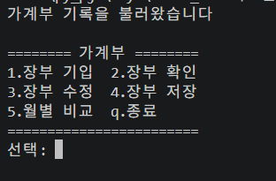
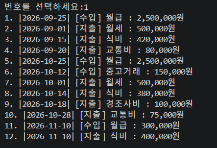
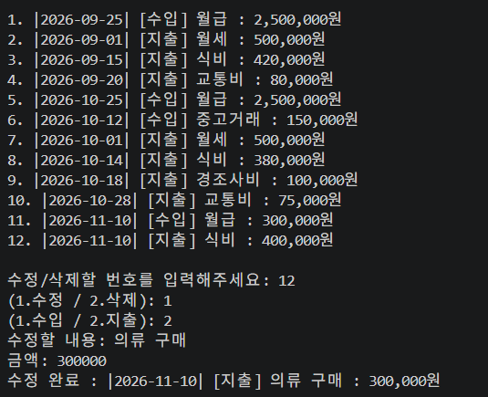
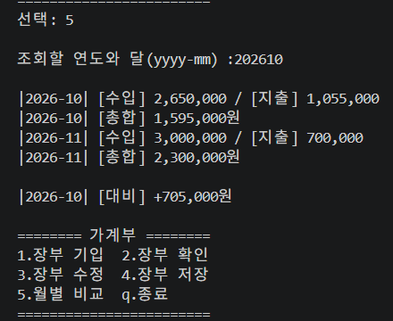

# 가계부 프로그램 (MoneyBook)

> 수입지출을 기록하고 저장 할 수 있는 프로그램

ASAC 데이터 엔지니어링 2기 Day 6~7 실습으로 만든 콘솔 가계부입니다. 2인 팀 미니 프로젝트로, 설계는 Day 6, 완성은 Day 7에 했습니다.

## 주제 카드

| 항목 | 내용 |
| --- | --- |
| 난이도 | ★★ |
| 필수 기능 | ① 내역 입력 ② 내역 확인 ③ 카테고리별(수입/지출) 합계 ④ 저장 |
| 선택 기능 | 메뉴 안에 서브메뉴로 편리성 확보 · 가계부 수정기능 · 월별 지출내역 비교 |
| 쓸 개념 | 클래스 / 딕셔너리 / JSON / datetime |

## 기능

| 메뉴 | 메서드 | 하는 일 |
| --- | --- | --- |
| 1. 장부 기입 | `add_records()` | 수입/지출을 고르고 내용·금액 입력. 날짜는 오늘로 자동 기록 |
| 2. 장부 확인 | `show_records()` · `get_kind()` · `get_month()` | 전체 / 수입 / 지출 / 월별 내역과 합계 |
| 3. 장부 수정 | `revise()` | 번호로 골라 수정 또는 삭제 |
| 4. 장부 저장 | `save()` | `MoneyBook.json`에 저장 (실행할 때 `load()`로 자동 불러오기) |
| 5. 월별 비교 | `month_diff()` | 고른 달과 이번 달의 수입·지출 합계 비교 |
| q. 종료 | | `q` 또는 `ㅂ` |

## 구조

| 클래스 | 역할 |
| --- | --- |
| `Record` | 기록 한 건 (구분·내용·금액·날짜) |
| `MoneyBook` | 기록 여러 건을 관리하는 장부 (`self.records`) |

## 실행 방법

Python 3.9 이상, 외부 라이브러리 없이 실행됩니다.

```bash
cd day07_moneybook
python moneybook.py
```

`MoneyBook.json`은 예시 데이터입니다. 프로그램과 같은 폴더에서 실행하면 자동으로 불러옵니다. 파일이 없으면 새 장부로 시작합니다.

월별 비교는 실행한 날의 달을 '이번 달'로 잡습니다. 예시 데이터는 2026년 9~11월 기록입니다.

## 실행 화면

| 메뉴 | 전체 장부 |
| --- | --- |
|  |  |

| 수정 | 월별 비교 |
| --- | --- |
|  |  |

## 블로그 정리

- [Day 6 | 데이터 구조부터 정했어야 했다: 갈피를 못 잡은 가계부 만들기](https://specialatsd.tistory.com/21)
- [Day 7 | 완성한 미니 프로젝트: 가계부 프로그램 완성하기](https://specialatsd.tistory.com/22)
- [가계부 프로그램 완성: 클래스·JSON·datetime으로 만든 콘솔 장부](https://specialatsd.tistory.com/23)
